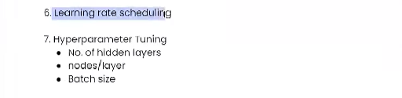

- This readme file tells the flow of the learning process of the course.

- First we will cover ANN then move towards CNN and RNN
- **Day 1**: [What is DL](./D1-What-Is-DL/)

- **Day 2**: [Types of NN](./D2-Types-of-NN/)

- **Day 3**: [What is Perceptron](./D3-What-Is-Perceptron/)

- **Day 4**: [How To Train Perceptron](./D4-How-To-Train-Perceptron/)

- **Day 5**: [Perceptron Loss Function](./D5-Perceptron-loss-function/)

- **Day 6**: [Problem with Perceptron](./D6-Problem-with-Perceptron/)

- **Day 7**: [Multi Layer Perceptron](./D7-Multi-Layer-Perceptron/)

- **Day 8**: [Forward Propagation](./D8-Forward-Propagation/)

- **Day 9**: [Customer Churn Prediction](./D9-Customer-Churn-Prediction/)

- **Day 10**: [Hand written Digit Classification](./D10-Hand-written-digit-classification/)

- **Day 11**: [Graduate Admission Prediction](./D11-Graduate-Admission-Prediction/)

- From day 19 onwards we will be covering the ways to improve the performance of the model

- The instructor had picked topics form the above list first which are small and easier