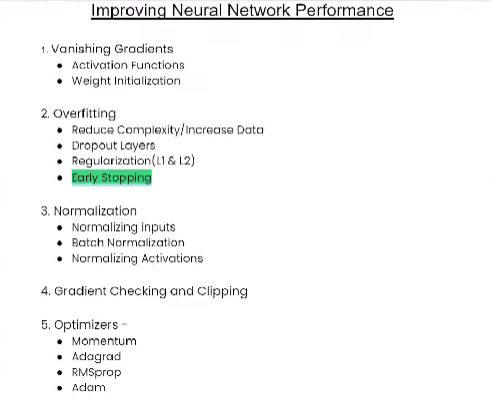

# Deep Learning Journey

Day-by-day notes and code from my deep learning course. The path: **ANN first, then CNN and RNN**. Each day lives in its own folder with notebooks (theory and/or code).

## Contents

### 1. Foundations
| Day | Topic |
|-----|-------|
| 1 | [What is Deep Learning](./D1-What-Is-DL/) |
| 2 | [Types of Neural Networks](./D2-Types-of-NN/) |

### 2. Perceptron
| Day | Topic |
|-----|-------|
| 3 | [What is a Perceptron](./D3-What-Is-Perceptron/) |
| 4 | [How to Train a Perceptron](./D4-How-To-Train-Perceptron/) |
| 5 | [Perceptron Loss Function](./D5-Perceptron-loss-function/) |
| 6 | [Problem with Perceptron](./D6-Problem-with-Perceptron/) |

### 3. Multi-Layer Perceptron (MLP)
| Day | Topic |
|-----|-------|
| 7 | [Multi Layer Perceptron](./D7-Multi-Layer-Perceptron/) |
| 8 | [Forward Propagation](./D8-Forward-Propagation/) |

### 4. Hands-on Projects
| Day | Topic |
|-----|-------|
| 9 | [Customer Churn Prediction](./D9-Customer-Churn-Prediction/) |
| 10 | [Handwritten Digit Classification](./D10-Hand-written-digit-classification/) |
| 11 | [Graduate Admission Prediction](./D11-Graduate-Admission-Prediction/) |

### 5. Training Neural Networks
| Day | Topic |
|-----|-------|
| 12 | [Loss Functions in DL](./D12-Loss-Func-In-DL/) |
| 13 | [Backpropagation](./D13-Backpropagation/) |
| 14 | [Gradient Descent in NN](./D14-Gradient-Descent-In-NN/) |
| 15 | [MLP Memoization](./D15-MLP-Memoization/) |
| 16 | [Vanishing Gradient Problem](./D16-Vanishing-Gradient-Problem/) |

### 6. Improving Performance

> The instructor picks topics from the list above in order of difficulty, starting with the smaller and easier ones.

| Day | Topic |
|-----|-------|
| 17 | [Improve Performance of NN](./D17-Improve-Performance-Of-NN/) |
| 18 | [Early Stopping](./D18-Early-Stopping/) |
| 19 | [Data (Feature) Scaling in NN](./D19-Data-Scaling-In-NN/) |

## Upcoming
CNN, RNN, and more ways to improve model performance (see roadmap above).
